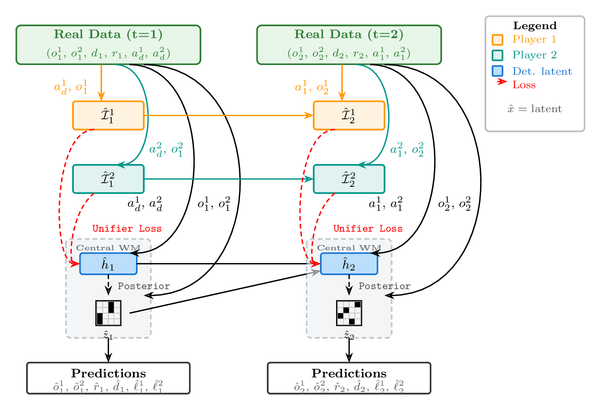
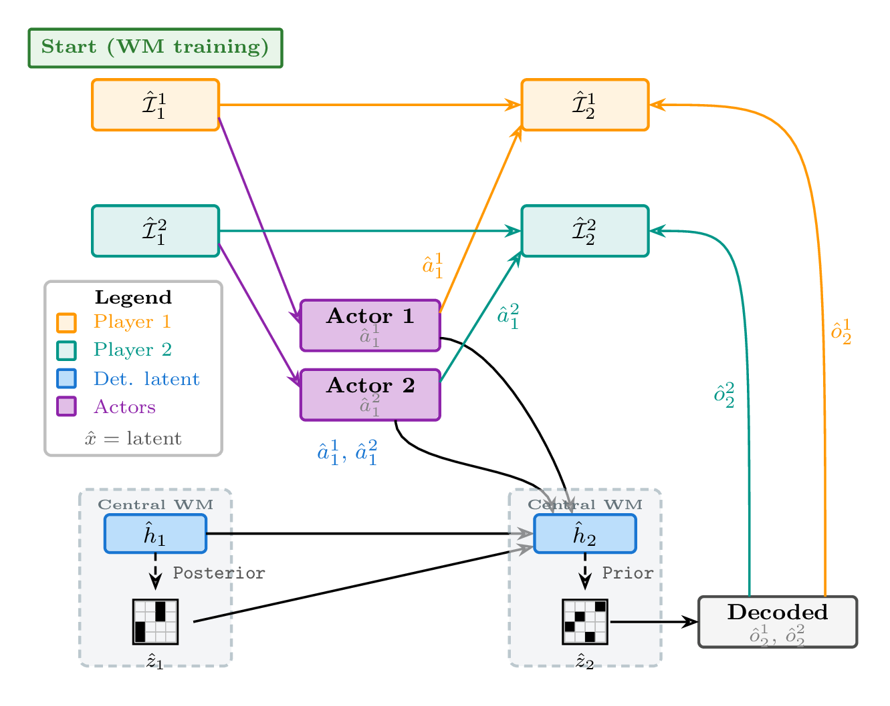

# NashDreamer

Official implementation of **NashDreamer: Model-Based Reinforcement Learning for Zero-Sum
Imperfect-Information Games** (Tomáš Holeček, Viliam Lisý), NeurIPS 2026 —
[arXiv:2609.01549](https://arxiv.org/abs/2609.01549).

NashDreamer is a multi-agent extension of the DreamerV3 world model framework for two-player zero-sum
imperfect-information games. We train a centralized world model with decentralized execution via latent
infosets.

## Table of Contents

- [Method](#method)
  - [World-model training](#world-model-training)
  - [Imagination and actor-critic](#imagination-and-actor-critic)
- [Repository Structure](#repository-structure)
- [Requirements](#requirements)
- [Training](#training)
  - [Using the shell scripts](#using-the-shell-scripts)
- [Evaluation](#evaluation)
- [Pre-computed Metrics](#pre-computed-metrics)
- [Citation](#citation)

## Method

In multi-agent settings, a world model learned separately by each player cannot tell the effect of the
opponent's strategy apart from the environment dynamics. NashDreamer therefore follows Centralized
Training with Decentralized Execution (CTDE): a centralized **Multi-Agent Recurrent State-Space Model
(MARSSM)** learns the dynamics of the game from the joint actions and observations of both players,
while a separate recurrent **infoset model** per player aggregates only that player's own
action-observation history into a latent infoset. Each player's actor acts on its own latent infoset
alone, so the learned policies remain executable in the real game without access to hidden information.

The actor-critic is a game-theoretic policy-gradient method trained on both real and imagined
trajectories. Two are implemented and interchangeable: **NashDreamer[RNaD]** (Regularized Nash
Dynamics) and **NashDreamer[MMD]** (Magnetic Mirror Descent). Under an idealized model, NashDreamer
inherits their convergence guarantees.

### World-model training

<p align="center">
  
</p>

Two steps of NashDreamer world-model training on a real trajectory. The centralized RSSM is unrolled on
the joint action and joint observation, the infoset model separately for each player. All stochastic
states are posterior. The KL losses are omitted; $a_d$ is the initial dummy action.

### Imagination and actor-critic

<p align="center">
  
</p>

Two imagined steps. Imagination is grounded in a posterior model state taken from world-model training
and proceeds with prior stochastic states. The observation decoder is required during imagination,
since the infoset model consumes observations.

## Repository Structure

Python source lives under `src/`, as a set of flat, sibling packages (not nested under one top-level
package) — `import train.goofspiel_train`, `import envs.jax_leduc`, etc. all resolve directly once
`src/` is on `PYTHONPATH`, no `src.` prefix needed.

```
.
├── src/
│   ├── nash_dreamer/          # The learners: world model, actor-critics, replay buffers
│   │   ├── dreamer_ma.py          #   Top-level model combining world model and actor-critic
│   │   ├── ma_rssm.py             #   Multi-agent Recurrent State Space Model (MA-RSSM)
│   │   ├── rnad_dreamer.py        #   RNaD actor-critic adapted for imagined Dreamer trajectories
│   │   ├── mmd_dreamer.py         #   MMD actor-critic adapted for imagined Dreamer trajectories
│   │   ├── dreamer_actor_critic.py #  REINFORCE + TD(λ) actor-critic for Dreamer
│   │   ├── networks.py            #   Neural network building blocks
│   │   ├── distributions.py       #   Categorical / symlog distribution utilities
│   │   ├── optimizer.py           #   Optimizer and learning-rate schedule construction
│   │   ├── replay_buffer.py       #   Experience replay buffer
│   │   ├── sim_rnad.py            #   Standalone RNaD baseline (no world model)
│   │   ├── sim_mmd.py             #   Standalone MMD baseline (no world model)
│   │   ├── sim_ppo.py             #   Standalone PPO best-response learner
│   │   ├── train_utils.py         #   Checkpointing, logging, configuration dataclasses
│   │   └── *_decentralized.py     #   One-RSSM-per-player ablation variant (RNaD only)
│   │
│   ├── envs/                  # JAX-accelerated game implementations
│   │   ├── jax_game.py            #   Abstract JaxGame base class
│   │   ├── jax_goofspiel.py       #   Goofspiel (configurable number of cards)
│   │   ├── jax_leduc.py           #   Leduc Poker (full and one-round variants)
│   │   ├── jax_battleships.py     #   Battleships
│   │   ├── jax_phantom_ttt.py     #   Phantom Tic-Tac-Toe
│   │   ├── jax_rps.py             #   Rock-Paper-Scissors (and jax_rps_perturbed.py)
│   │   ├── jax_point_card_matching.py # A toy single agent game environment
│   │   └── model_game.py          #   Walks the real game and the latent world model together;
│   │                               #   used to compute best responses/expected return in latent space. Only tractable for small games/models
│   │
│   ├── train/                 # Per-game entry points and the shared training loop
│   │   ├── goofspiel_train.py, leduc_train.py, battleships_train.py, pcm_train.py,
│   │   │   rps_train.py, strength_duel_train.py, phantom_ttt_train.py, perturbed_rps_train.py
│   │   ├── joint_train.py         #   Shared NashDreamer/RNaD/MMD/PPO training loop
│   │   ├── joint_train_decentralized.py
│   │   └── parsing_utils.py       #   Shared argument definitions
│   │   (see src/train/README.md for details)
│   │
│   ├── eval/                  # Evaluation
│   │   ├── actor_critic_evaluate.py   # NashConv / return evaluation
│   │   ├── head_to_head_evaluate.py   # Head-to-head win-rate evaluation
│   │   ├── policy_eval_utils.py       # Exact tree-walk NashConv/best-response (small games only)
│   │   ├── ppo_exploitability.py      # Budgeted approximate exploitability via SimPPO
│   │   └── pttt_exploitability/       # Exact Phantom TTT exploitability via the external `eas` solver
│   │   (see src/eval/README.md for details)
│   │
│   ├── plotting/              # plot_metrics.py and the world-model plot scripts (src/plotting/README.md)
│   ├── world_model_experiments/   # World-model quality checks against a trained checkpoint (src/world_model_experiments/README.md)
│   └── tabular_experiments/   # Scratch
│
├── *_train.sh, *_evaluate.sh, ...  # Root-level launcher scripts (see below)
├── pyproject.toml, uv.lock         # Dependencies (see Requirements)
```

## Requirements

Python 3.12.1+, with the primary dependencies being JAX and Flax NNX (built for CUDA 12). Dependencies
are managed with [uv](https://docs.astral.sh/uv/):

```bash
uv sync
```

This creates `.venv/` from the pinned `uv.lock`. Prefer running commands with `uv run` rather than
activating `.venv` and calling `python` directly — `uv run` always resolves *this* project's own
locked environment regardless of what else is active in your shell:

```bash
uv run python -m train.goofspiel_train --num_cards 3 rnad --num_steps 1000 --seeds "(42,)"
```

Every command below assumes `PYTHONPATH=src` is set (needed so the `train.`/`eval.`/`envs.`/etc.
packages under `src/` resolve) and that you're running from the repository root, since checkpoint and
metric paths are written relative to it. All of the shell scripts under "Using the shell scripts"
already set this up internally — export it yourself only when calling a module directly:

```bash
export PYTHONPATH="$(pwd)/src"
```

## Training

Each game has a dedicated entry-point module under `src/train/`. All training scripts accept a positional argument selecting the algorithm:

- `nash_dreamer` — world model + actor-critic (NashDreamer)
- `rnad` — standalone RNaD baseline (no world model)
- `mmd` — standalone MMD baseline (no world model)
- `ppo` — single-agent PPO best response against a frozen, already-trained opponent

Trained models are saved under `trained_networks/<algo>/<game>/seed_<N>/` by default.

### Using the shell scripts

Run from the project root:

```bash
# NashDreamer on Goofspiel with RNaD actor-critic (default settings)
./nash_dreamer_train.sh

# NashDreamer on Leduc Poker with REINFORCE actor-critic
GAME=leduc ALGO=reinforce ./nash_dreamer_train.sh

# Standalone RNaD baseline on Goofspiel
./rnad_train.sh

# RNaD baseline on Leduc Poker
GAME=leduc ./rnad_train.sh
```

Override any parameter by setting the corresponding environment variable before the script:

```bash
# Custom learning rate, single seed
GAME=goofspiel ALGO=reinforce OPT_FLAGS="--lr 0.001" SEEDS="(42,)" ./nash_dreamer_train.sh

# Continue training from a previous checkpoint (do not wipe the directory)
GAME=goofspiel EXPERIMENT_ADD_FLAGS="--continue_train" ./nash_dreamer_train.sh
```

The standalone-baseline and PPO-best-response scripts (`rnad_train.sh`, `mmd_train.sh`,
`ppo_train.sh`) follow the same `GAME=... VAR=... ./script.sh` pattern. See
[src/train/README.md](src/train/README.md) for calling the training modules directly, the full
per-game and per-algorithm flag reference, and other training-process details.

## Evaluation

NashDreamer ships three evaluation protocols — see [src/eval/README.md](src/eval/README.md) for usage:

- **NashConv / policy quality** (`nash_dreamer_evaluate.sh`) — exact or best-response game-value
  metrics for one or more trained algorithms across seeds.
- **Head-to-head play** (`head_to_head.sh`) — win rates from playing two trained policies against
  each other.
- **Approximate PPO best response** (`ppo_exploitability.sh`) — a budgeted best-response search,
  usable on games too large for the exact protocols above.

## Pre-computed Metrics

The `precomputed_metrics/` directory contains pre-computed evaluation results (NashConv, head-to-head win rates) across all games and seeds reported.

## Citation

If you use NashDreamer in your research, please cite:

```bibtex
@inproceedings{holecek2026nashdreamer,
  title         = {{NashDreamer}: Model-Based Reinforcement Learning for Zero-Sum Imperfect-Information Games},
  author        = {Hole{\v{c}}ek, Tom{\'a}{\v{s}} and Lis{\'y}, Viliam},
  booktitle     = {Advances in Neural Information Processing Systems},
  year          = {2026},
  eprint        = {2609.01549},
  archivePrefix = {arXiv},
  primaryClass  = {cs.LG},
  url           = {https://arxiv.org/abs/2609.01549}
}
```
